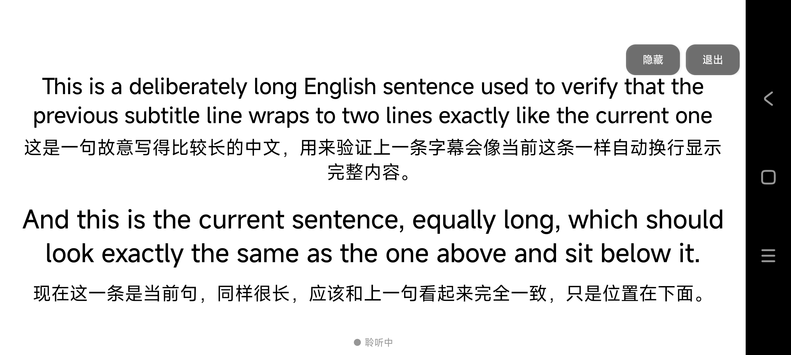
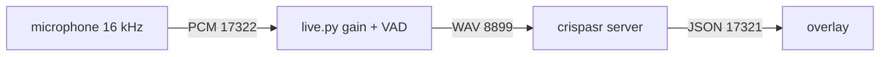

<p align="center">
  
</p>

<h1 align="center">IndexTranslate · Real-time zh⇄en subtitles on Xiaomi 15</h1>

<p align="center">
  <b>100% offline · true overlay · bidirectional · no root</b><br>
  <sub>Xiaomi 15 / Android 16 / HyperOS · Termux + CrispASR + Index-Echo-2B Q8</sub>
</p>

<p align="center">
  <a href="README.md">简体中文</a> ·
  <a href="README.en.md">English</a>
</p>

<p align="center">
  <a href="LICENSE"></a>
  <a href="https://github.com/Baizhi-Angelica/IndexTranslate_OnXiaomi/releases"></a>
  
  
  
  
</p>

## 🎯 What is this

Real-time Chinese⇄English subtitles that run **entirely on an Android phone**:
speak, and a full-screen white overlay shows the **translation in large text** with the
**transcript in small text** above whatever app is open. Audio never leaves memory and never
touches the network.

Everything runs inside Termux: the model is
[Index-Echo-S2TT-2B](https://huggingface.co/IndexTeam/Index-Echo-S2TT-2B) from Bilibili's Index team,
the runtime is [CrispASR](https://github.com/CrispStrobe/CrispASR).

> Originally built for a small gathering with a few international students: put the phone
> on the table in landscape and it becomes a bilingual subtitle screen.

## ✨ Features

| | |
|---|---|
| 🔒 **Fully local** | audio stays in RAM — no files, no network, works offline |
| ⚡ **Real time** | ~2.5–4 s per sentence (5 s segments, 2B model on CPU) |
| ↔️ **Bidirectional** | zh→en and en→zh switch automatically; large translation + small transcript |
| 🧩 **Code-switch safe** | translation direction is anchored on the transcript text, not on the model's guess about the spoken language |
| 🖥 **Pure white / black** | `#FFFFFF` background, `#000000` text, readable from ~5 m |
| 🪟 **True overlay** | `TYPE_APPLICATION_OVERLAY` above other apps, with Hide / Exit |
| 🔓 **No root needed** | day-to-day use is one `start.sh` in Termux |
| 🔄 **Auto rotation** | follows the system; nothing is forced or modified |

## ⚡ Performance (measured)

4 s speech, 7 threads, Q8 model, idle device:

| Stage | Time | Note |
|---|---:|---|
| mel + audio encode | ~0.84 s | ~0.21 s per second of audio |
| decoder prefill | ~0.83 s | audio tokens + prompt |
| autoregressive decode | ~2.18 s | memory-bandwidth bound, ~56% |
| **total** | **~3.9 s** | 2 s utterances take ~2.6–3.1 s |

- Segments are capped at **5 s**: shorter clips break long sentences, longer ones add latency.
- When the model falls behind, the bridge **drops the oldest pending segment** and keeps the
  newest (queue of 3 by default).
- Tunables: `ITX_QUEUE_MAX`, `ITX_STALE_S`, `ITX_MAX_TOKENS`.

> Why not Q4 or the NPU? See [docs/PROJECT-NOTES.md](docs/PROJECT-NOTES.md) (Chinese).

## 🚀 Quick start

### 1. Install the APK

Download [`release/ITX-Subtitle-1.3.apk`](release/ITX-Subtitle-1.3.apk) and install it.

Grant two permissions (on MIUI **both** are required, otherwise the microphone silently returns zeros):

```bash
su -c 'appops set com.itx.overlay SYSTEM_ALERT_WINDOW allow'
su -c 'pm grant com.itx.overlay android.permission.RECORD_AUDIO'
su -c 'appops set com.itx.overlay RECORD_AUDIO allow'
su -c 'pm grant com.itx.overlay android.permission.POST_NOTIFICATIONS'
su -c 'cmd deviceidle whitelist +com.itx.overlay'
```

Without root, enable "Display over other apps", microphone, autostart and unrestricted battery
by hand.

### 2. Set up the engine

Follow the [deployment guide](docs/deploy.md) (Termux, model download, CrispASR build), then copy
the three scripts from `itx/` to `~/itx/` on the phone:

```text
~/itx/live.py      # bridge: mic → gain → VAD → model → subtitles
~/itx/start.sh     # start engine + auto-launch the app
~/itx/stop.sh      # stop engine, free model memory
```

### 3. Run

```bash
bash ~/itx/start.sh
```

After ~5 s the app opens by itself in subtitle mode (`● 聆听中`). Start talking.

## 🧠 How it works



- The app records 16 kHz mono and hands PCM to `live.py` over a local socket;
- `live.py` applies 8× gain and VAD, packs each utterance into an in-memory WAV and POSTs it to
  the resident CrispASR server;
- the model returns transcript + translation; the bridge parses line order and pushes JSON lines
  to the overlay.

## 🔁 How bidirectional translation works

`--target-lang` only exposes en/ja/es, so the bridge rewrites the model instruction with `--ask`
and anchors the direction on the **transcript text** (letting the model guess the spoken language
made it treat some Chinese as English and skip translation entirely):

```text
Output exactly two lines for each sentence, with no timestamps.
Line 1: the transcript in the language actually spoken.
Line 2: the translation into the other language. If line 1 contains Chinese
characters, line 2 must be English. If line 1 is fully English, line 2 must be
Chinese. Never repeat line 1 as line 2.
```

- Chinese speech → large English + small Chinese;
- English speech → large Chinese + small English;
- force a single direction with `export ITX_ASK='...'`.

On a 35-clip TTS regression set, 34 pass; the only miss is a 0.3 s "嗯。" below the VAD minimum.

## 🤖 One-command install for AI agents

```text
AGENTS.md                  hard constraints an agent must preserve
docs/agent-install.md      full deployment playbook (with prompts for the user)
docs/PROJECT-NOTES.md      measurements, decisions, rejected paths
tools/bootstrap_phone.sh   idempotent one-shot installer
```

On the phone, inside Termux:

```bash
git clone https://github.com/Baizhi-Angelica/IndexTranslate_OnXiaomi.git ~/itx-src
bash ~/itx-src/tools/bootstrap_phone.sh
```

It installs packages, the `hf` CLI, the 2.6 GB models, builds CrispASR and the APK, installs it,
grants permissions when root is available, and self-checks. Without root it prints the manual
permission steps.

## 📊 Tunables (`live.py`)

| Variable | Default | Meaning |
|---|---|---|
| `ITX_GAIN` | `8` | microphone digital gain (raw level ≈ −46 dBFS) |
| `ITX_VAD_MIN` | `110` | absolute VAD threshold |
| `ITX_SILENCE_MS` | `550` | silence that ends a sentence |
| `ITX_MAX_SEG_MS` | `5000` | maximum segment length (do not shorten) |
| `ITX_THREADS` | `7` | inference threads (**8 deadlocks**) |
| `ITX_QUEUE_MAX` | `3` | pending queue cap; oldest is dropped |
| `ITX_STALE_S` | `20` | skip a segment that waited longer than this |
| `ITX_MAX_TOKENS` | `160` | per-request decode cap |
| `ITX_ASK` | bidirectional prompt | override the instruction, e.g. single direction |

## 📁 Layout

```text
.
├─ README.md / README.en.md   Chinese / English docs
├─ LICENSE                    Apache License 2.0
├─ docs/
│  ├─ deploy.md               zero-to-running guide + pitfalls
│  ├─ agent-install.md        deployment playbook for agents
│  └─ PROJECT-NOTES.md        handover notes: timings, decisions, rejected paths
├─ itx/
│  ├─ live.py                 bridge
│  ├─ start.sh / stop.sh      start / stop
│  ├─ app/                    overlay app sources (Java)
│  └─ *.png                   screenshots
├─ release/
│  └─ ITX-Subtitle-1.3.apk    prebuilt APK
├─ tools/                     build / install / SSH helpers
└─ config/
   └─ phone.env.example       connection template (real values git-ignored)
```

## 📚 Docs

| Doc | Contents |
|---|---|
| [docs/deploy.md](docs/deploy.md) | zero-to-running guide + pitfall table |
| [docs/agent-install.md](docs/agent-install.md) | full deployment playbook for AI agents |
| [docs/PROJECT-NOTES.md](docs/PROJECT-NOTES.md) | measured timings, v1.3 fixes, rejected Q4/NPU paths |
| [AGENTS.md](AGENTS.md) | hard constraints before changing code |

## ⚠️ Limitations

- Sentences longer than 5 s are split into two cues.
- Under sustained speech the bridge intentionally **drops old segments**; raise `ITX_QUEUE_MAX` to keep more.
- Reopening the app in the same process right after Exit can leave the microphone muted on MIUI;
  `bash ~/itx/stop.sh && bash ~/itx/start.sh` recovers.
- Very quiet rooms can trigger an empty segment (returns immediately).
- Status-bar icons cannot be covered by third-party overlays.
- First start loads the model (~5 s).
- Only tuned/verified on Xiaomi 15 / HyperOS so far.

## 📄 License

Code in this repository is licensed under the [Apache License 2.0](LICENSE).

Third-party attributions are listed in [NOTICE](NOTICE); each component keeps its own license:

- [Index-Echo-S2TT-2B](https://huggingface.co/IndexTeam/Index-Echo-S2TT-2B) — Apache-2.0 (Bilibili Index team)
- [CrispASR](https://github.com/CrispStrobe/CrispASR) — see its LICENSE
- [bilibili/Index-Translate](https://github.com/bilibili/Index-Translate) — models and paper

## 🙏 Credits

- [bilibili/Index-Translate](https://github.com/bilibili/Index-Translate) — models and technical report
- [CrispStrobe/CrispASR](https://github.com/CrispStrobe/CrispASR) — GGUF inference runtime
- GGUF build: [cstr/index-echo-2b-GGUF](https://huggingface.co/cstr/index-echo-2b-GGUF)


---

<p align="center">
  <a href="README.md">简体中文</a> · <a href="README.en.md">English</a><br>
  <sub>If this project helps you, a ⭐ star is appreciated.</sub>
</p>

