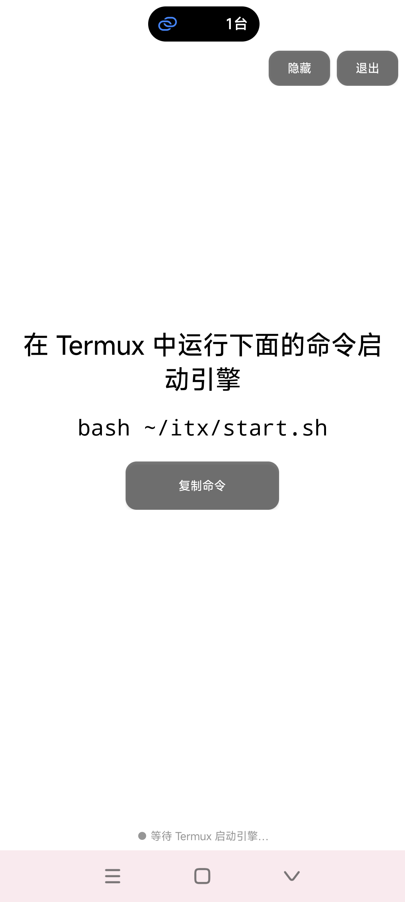
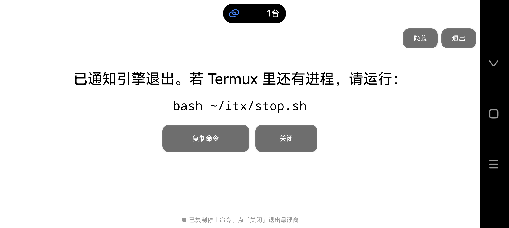

# IndexTranslate On Xiaomi 15

**Fully offline, real-time Chinese → English subtitle overlay for Android**, running entirely on the
phone inside Termux: speak Chinese, get large English text with a smaller Chinese reference line.
Rendered as a full-screen white overlay above other apps.

> Built and verified on a **Xiaomi 15 (Android 16 / HyperOS)**.
> Model: [Index-Echo-S2TT-2B](https://huggingface.co/IndexTeam/Index-Echo-S2TT-2B) (Bilibili Index team).
> Runtime: [CrispASR](https://github.com/CrispStrobe/CrispASR) (GGUF, C++, CPU).


## Features

- **Fully local** — audio never leaves RAM: no files, no network
- **Real time** — English appears ~2.5–4 s after a sentence ends (5 s speech segment; CPU limit of a 2B model)
- **Bidirectional** — zh→en and en→zh chosen automatically; 46sp translation + 21sp transcript, the **previous sentence keeps the same style** and can wrap to its own lines
- **Code-switch safe** — the translation direction is anchored on the transcript text, not on the model's guess about the spoken language
- **Pure white / black** — `#FFFFFF` background, `#000000` text, readable from ~5 m
- **True overlay** — `TYPE_APPLICATION_OVERLAY`, floats above other apps, with Hide / Exit buttons
- **No root needed** — day-to-day use is one command in Termux
- **Auto rotation** — follows the system; nothing is forced or modified

## Quick start

### 1. Install the APK

Download [`release/ITX-Subtitle-1.3.apk`](release/ITX-Subtitle-1.3.apk) and install it.

Grant two permissions (on MIUI **both** are required, otherwise the microphone silently returns zeros):

```bash
su -c 'appops set com.itx.overlay SYSTEM_ALERT_WINDOW allow'
su -c 'pm grant com.itx.overlay android.permission.RECORD_AUDIO'
su -c 'appops set com.itx.overlay RECORD_AUDIO allow'
su -c 'pm grant com.itx.overlay android.permission.POST_NOTIFICATIONS'
su -c 'cmd deviceidle whitelist +com.itx.overlay'
```

Without root, enable "Display over other apps", microphone permission and battery whitelist by hand.

### 2. Set up the engine

Follow the [deployment guide](docs/deploy.md) (Termux, model download, CrispASR build), then copy the
three scripts from `itx/` to `~/itx/` on the phone:

```
~/itx/live.py      # bridge: mic → gain → VAD → model → subtitles
~/itx/start.sh     # start engine + auto-launch the app
~/itx/stop.sh      # stop engine, free model memory
```

### 3. Run

```bash
bash ~/itx/start.sh
```

After ~5 s the app opens by itself in subtitle mode (`● 聆听中`). Speak Chinese.



Tap **Exit** on the overlay when done:



The app tells the engine to quit over a local socket (freeing the model), shows
`bash ~/itx/stop.sh` as a fallback (already copied to the clipboard), and closes on **Close**.

## One-command install for AI agents

The repo ships agent-facing docs and an idempotent installer:

```
AGENTS.md                  hard constraints an agent must preserve
docs/agent-install.md      full deployment playbook (with prompts to send the user)
tools/bootstrap_phone.sh   idempotent one-shot installer
```

On the phone, inside Termux:

```bash
git clone https://github.com/Baizhi-Angelica/IndexTranslate_OnXiaomi.git ~/itx-src
bash ~/itx-src/tools/bootstrap_phone.sh
```

It installs packages, the `hf` CLI, the 2.6 GB models, builds CrispASR and the APK, installs it,
grants permissions when root is available, and self-checks. Without root it prints the manual
permission steps to hand to the user.

## Architecture

```
microphone 16 kHz mono
      │  AudioRecord (foreground service, targetSdk 33)
      ▼  TCP 127.0.0.1:17322
  live.py ── 8× digital gain → energy VAD (0.55 s silence / max 5 s)
      │      audio packed to WAV in memory only
      ▼  HTTP 127.0.0.1:8899
  crispasr --server (index-echo-2b Q8, resident, 7 threads)
      │      Chinese transcript + English translation, line pairs
      ▼  TCP 127.0.0.1:17321 (JSON lines)
  overlay app (previous in grey / current large / Chinese small)
```

## Layout

```
.
├─ README.md                 Chinese (primary)
├─ README.en.md              this file
├─ docs/deploy.md            zero-to-running guide + 17 pitfalls
├─ itx/                      bridge, start/stop scripts, Android app sources
├─ release/ITX-Subtitle-1.3.apk
├─ tools/                    build / install / SSH helper scripts
└─ config/phone.env.example  connection template (real phone.env is git-ignored)
```

## Tunables (`live.py` environment variables)

| Variable | Default | Meaning |
|---|---|---|
| `ITX_GAIN` | `8` | microphone digital gain (raw level is about −46 dBFS) |
| `ITX_VAD_MIN` | `110` | absolute VAD threshold |
| `ITX_SILENCE_MS` | `550` | silence that ends a sentence |
| `ITX_MAX_SEG_MS` | `5000` | maximum segment length |
| `ITX_THREADS` | `7` | inference threads (8 deadlocks) |

## Limitations

- **Bidirectional (zh ⇄ en).** `--target-lang` only exposes en/ja/es, so the bridge instead
  rewrites the model instruction (`BIDIR_ASK`) to translate into *the other* language:
  Chinese speech → English big / Chinese small, English speech → Chinese big / English small.
- Sentences longer than 5 s are split into two subtitle entries.
- In very quiet rooms ambient noise can trigger a segment that transcribes to nothing (returns fast).
- Status-bar icons cannot be covered by third-party overlays (system restriction).
- First start loads the model (~5 s).

## Credits

- [bilibili/Index-Translate](https://github.com/bilibili/Index-Translate) — models and technical report
- [CrispStrobe/CrispASR](https://github.com/CrispStrobe/CrispASR) — GGUF inference runtime
