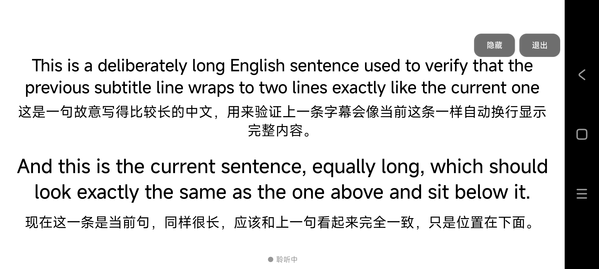
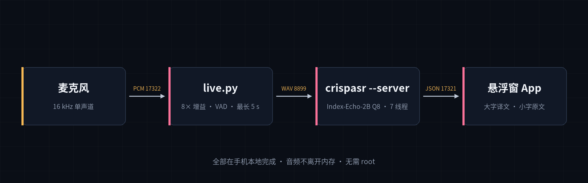

<p align="center">
  
</p>

<h1 align="center">IndexTranslate · 小米 15 本地实时中英字幕</h1>

<p align="center">
  <b>全离线 · 真悬浮窗 · 中英双向 · 无需 root</b><br>
  <sub>小米 15 / Android 16 / HyperOS · Termux + CrispASR + Index-Echo-2B Q8</sub>
</p>

<p align="center">
  <a href="README.md">简体中文</a> ·
  <a href="README.en.md">English</a>
</p>

<p align="center">
  <a href="LICENSE"></a>
  <a href="https://github.com/Baizhi-Angelica/IndexTranslate_OnXiaomi/releases"></a>
  
  
  
  
</p>

## 🎯 这是什么

在 Android 手机上跑**本地实时中英字幕**：说话 → 屏幕上出现**大字译文 + 小字原文**，
全屏纯白悬浮窗盖在任意 App 之上，全程离线，音频不落盘、不上传。

整套推理跑在 Termux 里：模型是 B 站 Index 团队的
[Index-Echo-S2TT-2B](https://huggingface.co/IndexTeam/Index-Echo-S2TT-2B)，
运行时是 [CrispASR](https://github.com/CrispStrobe/CrispASR)。

> 最初是为下个月导师的小聚会做的：会来几位外国学生，一桌人聊天需要双语。
> 手机横放在桌上就是一块字幕屏。

## ✨ 特性

| | |
|---|---|
| 🔒 **纯本地** | 音频只在内存里流转，不落盘、不联网，断网也能用 |
| ⚡ **实时** | 一句说完约 2.5–4 秒出字幕（5 秒语音段，2B 模型 CPU 推理） |
| ↔️ **双向互译** | 中文→英文、英文→中文自动切换；大字译文、小字原文 |
| 🧩 **中英混说也不丢翻** | 译文方向按转写文本判定，不靠模型猜语种；夹英文、语气像英文也不会整句不翻 |
| 🖥 **全屏白底黑字** | `#FFFFFF` / `#000000`，5 米内可读 |
| 🪟 **真悬浮窗** | `TYPE_APPLICATION_OVERLAY`，盖在视频、会议、直播之上，带「隐藏 / 退出」 |
| 🔓 **不需要 root** | 日常使用只要在 Termux 里一条 `start.sh` |
| 🔄 **方向跟随系统** | 不强制、不修改任何系统设置 |

## ⚡ 性能（实测）

4 秒语音、7 线程、Q8 模型、干净状态：

| 阶段 | 耗时 | 说明 |
|---|---:|---|
| mel + 音频编码 | ~0.84 s | 约 0.21 s / 秒音频 |
| 解码器预填充 | ~0.83 s | 音频 token + prompt |
| 自回归生成 | ~2.18 s | 内存带宽瓶颈，占 ~56% |
| **合计** | **~3.9 s** | 2 秒短句约 2.6–3.1 s |

- 单段最长 **5 秒**：再短会把一句话切碎、明显掉翻译质量；再长则延迟变大。
- 持续说话、模型追不上时，桥接**丢掉最旧的待处理片段**，优先保证最新一句（默认 3 段）。
- 可调：`ITX_QUEUE_MAX`、`ITX_STALE_S`、`ITX_MAX_TOKENS`。

> 为什么不做 Q4 / NPU？见 [docs/PROJECT-NOTES.md](docs/PROJECT-NOTES.md)。

## 🚀 快速开始

### 1. 安装 APK

下载 [`release/ITX-Subtitle-1.3.apk`](release/ITX-Subtitle-1.3.apk) 并安装（需允许"安装未知应用"）。

安装后给两个权限（**MIUI 必须两个都给**，否则录音会静默返回全 0）：

```bash
su -c 'appops set com.itx.overlay SYSTEM_ALERT_WINDOW allow'
su -c 'pm grant com.itx.overlay android.permission.RECORD_AUDIO'
su -c 'appops set com.itx.overlay RECORD_AUDIO allow'
su -c 'pm grant com.itx.overlay android.permission.POST_NOTIFICATIONS'
su -c 'cmd deviceidle whitelist +com.itx.overlay'
```

没有 root 也可以：在系统设置里手动开启"显示在其他应用的上层"、麦克风、自启动和电池无限制。

### 2. 准备引擎

按 [部署指南](docs/deploy.md) 装好 Termux + 模型 + CrispASR，然后把 `itx/` 下的三个脚本放进手机 `~/itx/`：

```text
~/itx/live.py      # 桥接：麦克风 → 增益 → VAD → 模型 → 字幕
~/itx/start.sh     # 启动引擎 + 自动拉起 App
~/itx/stop.sh      # 停止引擎、释放内存
```

### 3. 使用

```bash
bash ~/itx/start.sh
```

约 5 秒后 App 自动弹出并进入字幕模式（状态「● 聆听中」），对着手机说话即可。

## 🧠 工作方式

<p align="center">
  
</p>

- App 采集 16 kHz 单声道，经本地 socket 交给 `live.py`；
- `live.py` 做 8× 数字增益和 VAD，按句打包成内存 WAV，POST 给常驻的 CrispASR 服务；
- 模型输出「转写 + 译文」，桥接按行解析后通过 JSON 行推给悬浮窗。

## 🔁 双向互译是怎么做的

CrispASR 的 `--target-lang` 只暴露 en/ja/es，无法直接指定"翻成中文"。所以用 `--ask` 改写指令，
并把**译文方向锚定在转写文本**上（不是让模型猜音频语种——那样会把部分中文判成英文、整句不翻）：

```text
Output exactly two lines for each sentence, with no timestamps.
Line 1: the transcript in the language actually spoken.
Line 2: the translation into the other language. If line 1 contains Chinese
characters, line 2 must be English. If line 1 is fully English, line 2 must be
Chinese. Never repeat line 1 as line 2.
```

- 说中文 → 英文大字 + 中文小字；
- 说英文 → 中文大字 + 英文小字；
- 想固定单向：启动前 `export ITX_ASK='...'` 覆盖即可。

实测：35 条 TTS 回归集 34 条正确；唯一失败是 0.3 秒的"嗯。"（低于 VAD 最小语音）。
细节和踩坑见 [docs/PROJECT-NOTES.md](docs/PROJECT-NOTES.md)。

## 🤖 给 AI Agent 的一键部署

仓库自带面向自动化 agent 的说明和引导脚本：

```text
AGENTS.md                  agent 必读的硬约束
docs/agent-install.md      完整部署剧本（含发给用户的话术）
docs/PROJECT-NOTES.md      实测数据 / 历史决策 / 已否决路线
tools/bootstrap_phone.sh   幂等的一键安装脚本
```

手机 Termux 里两条命令：

```bash
git clone https://github.com/Baizhi-Angelica/IndexTranslate_OnXiaomi.git ~/itx-src
bash ~/itx-src/tools/bootstrap_phone.sh
```

脚本依次：装系统包 → 装 `hf` → 下模型（2.6 GB）→ 编 CrispASR → 编 APK → 装 APK → 授权 → 自检。
没有 root 也能跑，会打印手动授权步骤。

## 📊 可调参数（`live.py`）

| 变量 | 默认 | 说明 |
|---|---|---|
| `ITX_GAIN` | `8` | 麦克风数字增益（原始电平约 −46 dBFS） |
| `ITX_VAD_MIN` | `110` | VAD 绝对阈值 |
| `ITX_SILENCE_MS` | `550` | 静音多久算一句结束 |
| `ITX_MAX_SEG_MS` | `5000` | 单句最长长度（不建议再短） |
| `ITX_THREADS` | `7` | 推理线程数（**8 会死锁**） |
| `ITX_QUEUE_MAX` | `3` | 待处理队列上限，满了丢最旧 |
| `ITX_STALE_S` | `20` | 排队超过多少秒直接跳过 |
| `ITX_MAX_TOKENS` | `160` | 单次生成上限，防跑飞 |
| `ITX_ASK` | 双向指令 | 覆盖模型指令，可固定单向 |

## 📁 项目结构

```text
.
├─ README.md / README.en.md   中英文说明
├─ LICENSE                    Apache License 2.0
├─ docs/
│  ├─ deploy.md               新手机从零部署 + 踩坑记录
│  ├─ agent-install.md        给 agent 的部署剧本
│  └─ PROJECT-NOTES.md        交接笔记：耗时 / 决策 / 已否决路线
├─ itx/
│  ├─ live.py                 桥接引擎
│  ├─ start.sh / stop.sh      启动 / 停止
│  ├─ app/                    悬浮窗 App 源码（Java）
│  └─ *.png                   界面实拍
├─ release/
│  └─ ITX-Subtitle-1.3.apk    预编译 APK
├─ tools/                     构建 / 安装 / SSH 辅助脚本
└─ config/
   └─ phone.env.example       连接配置模板（真实值已 gitignore）
```

## 📚 文档

| 文档 | 内容 |
|---|---|
| [docs/deploy.md](docs/deploy.md) | 新手机从零部署 + 踩坑总表 |
| [docs/agent-install.md](docs/agent-install.md) | 给 AI agent 的完整部署剧本 |
| [docs/PROJECT-NOTES.md](docs/PROJECT-NOTES.md) | 实测耗时、v1.3 修复、Q4/NPU 等已否决路线 |
| [AGENTS.md](AGENTS.md) | 改代码前必读的硬约束 |

## ⚠️ 已知限制

- 单句超过 5 秒会被强制切分，字幕可能分成两条。
- 持续说话且模型追不上时会**主动丢旧句**（这是设计，不是 bug）；可用 `ITX_QUEUE_MAX` 调大。
- 点「退出」后如果在同一进程里马上重开，MIUI 可能让录音静音；`bash ~/itx/stop.sh && bash ~/itx/start.sh` 可恢复。
- 很安静的房间偶尔会被环境噪声触发，产生空转写（立即返回，不影响使用）。
- 状态栏图标无法被第三方悬浮窗覆盖（系统限制）。
- 首次启动加载模型约 5 秒。
- 目前只针对小米 15 / HyperOS 调过，其他机型需要重新验证。

## 📄 License

本仓库代码采用 [Apache License 2.0](LICENSE)。

第三方组件的署名见 [NOTICE](NOTICE)，各自遵循其许可证：

- [Index-Echo-S2TT-2B](https://huggingface.co/IndexTeam/Index-Echo-S2TT-2B) — Apache-2.0（B 站 Index 团队）
- [CrispASR](https://github.com/CrispStrobe/CrispASR) — 见其仓库 LICENSE
- [bilibili/Index-Translate](https://github.com/bilibili/Index-Translate) — 模型与论文

## 🙏 Credits

- [bilibili/Index-Translate](https://github.com/bilibili/Index-Translate) — 模型与论文
- [CrispStrobe/CrispASR](https://github.com/CrispStrobe/CrispASR) — GGUF 推理运行时
- 模型量化/GGUF 版本：[cstr/index-echo-2b-GGUF](https://huggingface.co/cstr/index-echo-2b-GGUF)


---

<p align="center">
  <a href="README.en.md">English</a> · <a href="README.md">简体中文</a><br>
  <sub>如果这个项目对你有帮助，欢迎点一个 ⭐ Star</sub>
</p>

